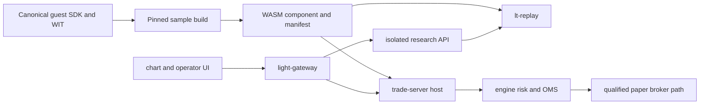

# Architecture and contracts

Build on the [compatibility baseline and ownership decision](compatibility.md); see the
[overview](overview.md) for repository delivery status.

## Repository roles

| Repository | Owns | Does not own |
|---|---|---|
| `light-trader` | Canonical WIT, guest SDK, host, engine, replay, feed and trade servers, migrations | User-specific trading rules or credentials |
| `light-trader-sample-strategy` | Pinned upstream sample builds, synthetic fixture/config templates, teaching guides and optional paper deployment template | A fork of the SDK, broker adapter, risk engine or gateway |
| A user's strategy repository | Private rules, research provenance, parameters and promotion decisions | Changes to the engine's safety contracts |
| `light-fabric/apps/light-gateway` | Browser routing, authentication and security integration | Strategy execution or broker reconciliation |

The identical component bytes are promoted from offline evaluation to paper. A guest has no
database URL, broker client ID, password, HTTP client or gateway session. All effects go through
the host. Public CI uses synthetic data and no broker credentials. Chart UI and research-job
hosting remain integrations owned by the services, not dependencies inside a guest.

## Plugin model

Follow Light-Trader's [WASM rationale, alternatives and concurrency contract](https://github.com/networknt/light-trader/blob/master/docs/src/design/plugins.md): the host serializes each instance's callbacks and coordinates shared-account risk while strategies supply deterministic decisions.

## Interface authority

Use `light-trader/wit/strategy.wit`, `guest/lt-strategy-guest` and the core contracts C1–C9 from
the pinned engine revision. WIT is currently `light-trader:strategy@0.1.0`. A matching version
string alone is not sufficient: record WIT content hash, SDK revision and actual host compatibility.
Do not assume an unverified `v0.1.0` Git tag, published crate or container image exists.

Rust implements `Strategy::init(&str) -> Result<(Self, StrategySpec), String>` and callbacks taking
`&Host`; `export_strategy!` supplies the component exports. `init` parses parameters and declares
account alias, instruments, data kinds, entitlement and calendar-relative timers. Query the host
in callbacks after initialization. Unknown keys, invalid instrument names and invalid numeric
parameters fail explicitly. JSON examples in sample chapters are guest parameters, not complete
trade-server or replay configuration files.

Keep the guest workspace separate from native server dependencies. Use `cdylib` for the component
and `rlib` where native tests need it. Native tests enable the SDK's `testing` feature only in
dev dependencies. `FakeHost` checks callback logic; it does not prove OMS, persistence, sandbox
enforcement or broker behavior. Test the compiled component with the real host and replay too.

## Time, data and deterministic decisions

- `host.now()` is the invocation's nondecreasing call time, not necessarily the event's exchange
  time. Observe `delivery()` for delayed/late delivery. Never read system time or use randomness.
- Historical replay uses its documented event ordering; decision replay follows the recorded
  delivery sequence and host calls. Never re-sort recorded calls by exchange timestamp.
- Query only completed bars available at the decision time. Specify end-exclusive bounds,
  RTH policy and warm-up. Current daily data is not complete at a pre-close timer.
- Resolve actual sessions through the configured calendar: DST, holidays, early closes and
  futures maintenance/roll rules are not fixed wall-clock constants.
- Preserve instrument identity, front contract, multiplier, tick size, fractional volume,
  missing-bar behavior, source/adjustment policy and entitlement in test evidence.
- Higher timeframe display bars are not replacements for minute/tick execution inputs.
- Sort unordered collections before making decisions. Compare numeric results with explicit
  tolerances, without tolerating different decision dates, directions or missing trades.

## Orders, recovery and state

`submit` and `submit_bracket` success means intent admission, not a fill or proof of broker
acceptance. A bracket strategy submits native protection with its entry; it must not submit an
unprotected entry and wait for a fill callback to create its stop. Host capability gates control
native bracket variants, partial-fill handling, child modification and flattening. Defaults remain
unsupported; simulation fixtures cannot enable broker capabilities in deployment configuration.

Use host positions and open orders for this strategy, not inferred account totals. Treat sending,
partial, unresolved and cancel-requested orders as outstanding. Never retry an uncertain order as
a new entry. Feed readiness must recover by its configured policy; a fresh tick is insufficient.
Stop/restart must not cancel protective orders. Missing protection or ambiguous state goes to the
host's reconciliation/operator flow, not a guest workaround.

Repository hardening must add versioned state where a sample can repeat an action after restart:
schema version, strategy identity, session/decision key, last evaluated input identity and returned
order/trade IDs. Validate restored state against host records before acting. A saved decision flag
is not an atomic transaction with a broker request: crash-window handling belongs to journal/OMS
recovery and must be tested through the host. Unknown/corrupt state pauses rather than resetting.
Carry state across sessions deliberately; `save_state` records and `load_state` behavior are host contracts.

Do not promise transparent hot upgrades. Default promotion is a reviewed stop/start at an allowed
state with compatible saved state, reconciliation and readiness recovery. Open positions/orders
require explicit recovery testing; never clear them to make a version change convenient.

## Artifact and configuration contract

Each build produces a component plus a manifest containing source commit, lockfile/toolchain,
SDK revision, WIT hash/version, component SHA-256, parameter schema version, state schema version,
tested host revision and fixture/report hashes. Production configuration pins the exact SHA-256.
Simulation policy is separate from paper capabilities. Record image digests when images become
available; do not track floating `latest` for accepted runs.

The SDK and ORB/SMA implementations remain canonical in Light-Trader. Template automation reads
`light-trader.rev`, checks out those sources and builds them without maintaining a copied fork.
External custom-strategy crates pin the same SDK revision and verify its bundled WIT assets in CI.
See [compatibility and ownership](compatibility.md) for the pin-update procedure.

## Acceptance boundary

Native tests → actual WASM/host tests → deterministic historical replay → decision replay →
separately supervised paper acceptance. Each result has independent evidence. The samples are
educational contract examples, not a claim of profitability or guaranteed broker protection.
See [implementation milestones](implementation.md) and [testing](testing.md).
